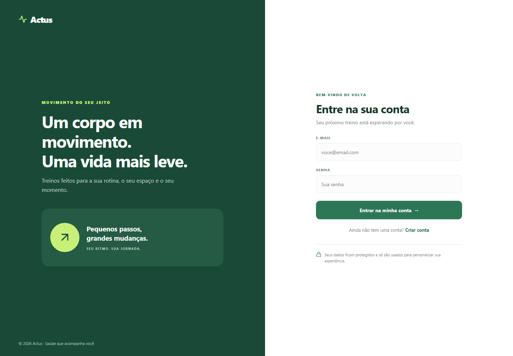
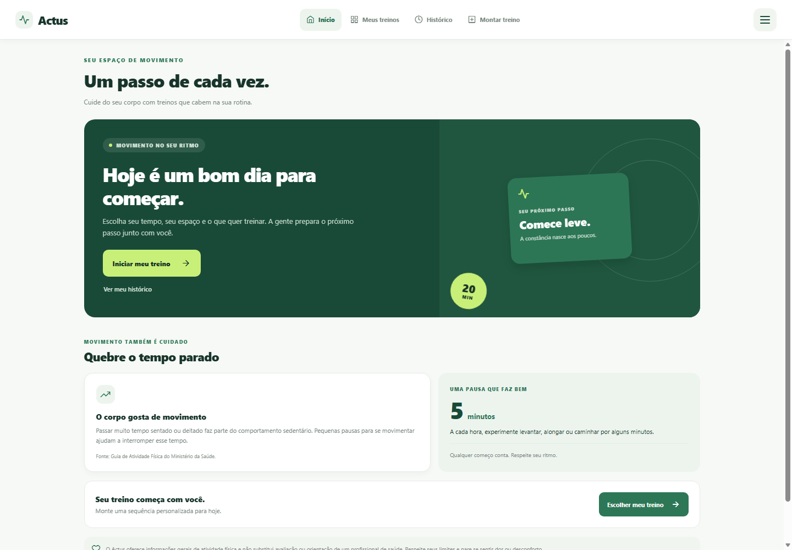
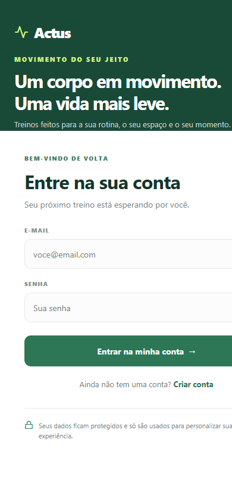
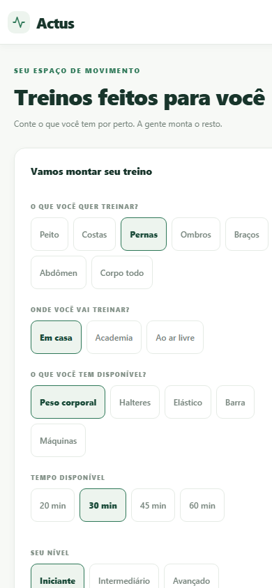

# Actus

Aplicativo mobile de bem-estar e atividade física. O Actus ajuda pessoas a começar ou retomar uma rotina ativa com treinos adaptados ao tempo disponível, ao local, aos equipamentos e ao nível de experiência.

## Problema e solução

A falta de tempo, equipamento ou orientação pode dificultar a prática regular de atividade física. O Actus organiza treinos simples e adaptáveis e permite acompanhar o progresso e consultar sessões concluídas.

## Funcionalidades

- Cadastro, login e logout com e-mail e senha.
- Perfis de usuário, profissional de saúde e administrador.
- Criação de treino por grupo muscular, local, equipamentos, duração e nível.
- Biblioteca de treinos personalizados com uma programação semanal: cada dia recebe um treino ou descanso.
- Sessão de treino com marcação de séries concluídas e salvamento do progresso.
- Histórico de treinos concluídos e exclusão de um treino do histórico.
- Perfil com nome e objetivo pessoal.
- Catálogo de exercícios administrado pela conta designada.
- Conversas entre usuários e profissionais de saúde, com envio de treinos personalizados pelo profissional.
- Preferência de tema salva no dispositivo.

## Navegação

O projeto usa Expo Router. As rotas estão em `src/app/`:

| Rota | Função |
| --- | --- |
| `login.js` | Cadastro e autenticação. |
| `inicio.js` | Entrada e apresentação do aplicativo. |
| `treino.js` | Preferências e criação de treino. |
| `rotina.js` | Biblioteca de treinos e planejamento de segunda a domingo. |
| `sessao.js` | Execução e progresso das séries. |
| `historico.js` | Treinos concluídos e exclusão. |
| `perfil.js` | Dados pessoais e objetivo. |
| `configuracoes.js` | Preferências do aplicativo. |
| `admin.js` | Administração de exercícios e contas. |
| `atendimentos.js`, `contato.js` | Diretório e comunicação com profissionais. |
| `privacidade.js` | Política de privacidade e direitos de dados. |

Visitantes ficam restritos ao login/cadastro. Usuários autenticados acessam os próprios dados. Profissionais mantêm um perfil público no diretório e participam de conversas com usuários. O administrador pode gerenciar o catálogo e consultar contas, mas não recebe acesso aos treinos privados de outras pessoas.

## Arquitetura e decisão sobre o backend

**O orientador autorizou o uso do Firebase no lugar de Express e MySQL neste projeto.** O app é feito com Expo e React Native; Firebase Authentication gerencia cadastro, senha e sessão, e Cloud Firestore persiste os dados. O Firebase emite tokens de identidade JWT; o SDK do Firebase os utiliza ao acessar o Firestore. Não há API REST própria, envio manual de Bearer Token ou servidor Express nesta solução aprovada.

```text
Expo / React Native
├── Firebase Authentication: cadastro, login, sessão e tokens de identidade
└── Firebase SDK → Cloud Firestore
                     └── firestore.rules: propriedade dos dados e permissões
```

### Dados e operações

| Coleção/caminho | Uso |
| --- | --- |
| `users/{uid}` | Perfil, e-mail, objetivo e tipo de conta. O ID corresponde ao UID do Authentication. |
| `users/{uid}/workouts/{workoutId}` | Treino, exercícios selecionados e séries concluídas. |
| `users/{uid}/customWorkouts/{workoutId}` | Biblioteca privada de treinos criada pela pessoa. |
| `users/{uid}/trainingSchedules/weekly` | Documento `days` com o treino escolhido ou descanso para cada dia. |
| `exercises/{exerciseId}` | Catálogo gerenciado pelo administrador. Há exercícios locais padrão em `src/lib/exercises.js` como fallback. |
| `professionals/{uid}` | Perfil publicado no diretório de profissionais. |
| `conversations/{id}` | Participantes aluno/profissional e metadados da conversa. |
| `conversations/{id}/messages/{messageId}` | Mensagem de texto ou mensagem com `workout` anexado e timestamp. O aluno pode salvar o treino recebido na própria coleção `workouts`. |
| `conversations/{id}/sendLimits/{uid}` | Último envio por participante; as regras exigem um intervalo de quatro segundos entre mensagens. |

O CRUD de treinos inclui criação, leitura, atualização do progresso e exclusão. O catálogo tem criação, leitura, atualização e exclusão, com escrita restrita ao administrador pelas regras do Firestore. Regras adicionais limitam perfis, diretório e mensagens aos respectivos proprietários ou participantes.

### Conversas entre usuários e profissionais

O profissional se cadastra com o número de registro e aguarda aprovação administrativa. Só perfis verificados aparecem em **Profissionais** e podem iniciar atendimentos. O usuário escolhe um profissional; o app cria uma conversa e grava a primeira mensagem. As telas **Profissionais** e **Atendimentos** escutam as conversas e mensagens em tempo real. Cada conversa tem um aluno e um profissional; as regras permitem leitura e envio somente a esses dois participantes. Na conversa, o profissional pode alternar entre texto e **Enviar treino**, escolher exercícios, nível e duração e anexar o plano. O aluno pode abrir o treino, que é salvo na conta dele antes de iniciar. Depois de publicar as regras, profissionais que já estavam cadastrados devem entrar novamente para sincronizar seu perfil no diretório.

## Apresentação e capturas — Entrega 4

As imagens abaixo registram telas reais do Actus e ajudam a apresentar a solução. O PDF da avaliação também pede demonstrações de autenticação, níveis de acesso, CRUD, banco de dados, repositório e APK; o roteiro após as imagens relaciona cada tópico à tela ou evidência correspondente.

| Login no desktop — entrada para cadastro e autenticação | Início no desktop — proposta e solução do Actus |
| --- | --- |
|  |  |

| Login no celular — fluxo de autenticação mobile | Montador no celular — criação e leitura de treino |
| --- | --- |
|  |  |

| Login no desktop — tema escuro do sistema |
| --- |
|  |

### Roteiro de demonstração

| Requisito da apresentação | Evidência no projeto | O que demonstrar ou explicar |
| --- | --- | --- |
| Problema e solução | [Descrição do problema](#problema-e-solução) e captura da tela inicial acima | A falta de tempo, equipamento ou orientação dificulta uma rotina ativa; o Actus adapta treinos ao contexto da pessoa. |
| Cadastro, login e sessão | Capturas de entrada acima; `src/app/login.js` e `src/context/AuthContext.js` | Alternar entre login e cadastro, entrar com uma conta de demonstração e sair. As imagens não usam credenciais reais. |
| JWT, token e controle de acesso | `src/context/AuthContext.js` e [`firestore.rules`](firestore.rules) | Firebase Authentication emite um token de identidade JWT; o SDK Firebase o envia ao Firestore. As regras verificam a identidade e as permissões no servidor. Não há API Express nem middleware JWT próprio nesta implementação autorizada pelo orientador. |
| Níveis de usuário | `src/context/AuthContext.js`, `src/app/admin.js` e `scripts/set-admin-claim.js` | Demonstrar conta comum, perfil profissional pendente/verificado e conta administradora. A administração usa o custom claim `admin: true`; aprovação profissional é uma permissão separada. |
| CRUD | Captura do montador acima; `src/app/treino.js`, `src/app/rotina.js`, `src/app/sessao.js`, `src/app/historico.js` e `src/app/admin.js` | Criar e consultar um treino, atualizar o progresso durante a sessão e removê-lo do histórico; no painel administrativo, criar, editar, listar e excluir exercícios. |
| Banco de dados | Tabela [Dados e operações](#dados-e-operações) e coleções no Cloud Firestore | Mostrar no Firebase Console as coleções `users`, `exercises`, `professionals` e `conversations`, usando uma conta de demonstração e sem expor credenciais. |
| Repositório e histórico | [Repositório Actus](https://github.com/AugustoKrst/Actus) · [histórico de commits](https://github.com/AugustoKrst/Actus/commits/main) | Mostrar a versão publicada, os commits da evolução e o README. Faça push da versão final antes de entregar. |
| APK final | [Baixar Actus.apk](https://expo.dev/artifacts/eas/9W4m2YJKBLYHnNBD_ES0kNxAV-cbqK8QWKUd2cVrp1A.apk) · [build na Expo](https://expo.dev/accounts/attoatt/projects/Actus/builds/7b819686-fd3c-485d-aaa1-1cdfecbfcec6) | Instalar o APK em Android compatível e demonstrar os fluxos principais. O build foi feito a partir do commit `13cf93ba073bc12a93de09b8196960bd0bd42e5d`. |

As capturas são ilustrativas da interface e não contêm dados pessoais. Use contas de demonstração nas partes que precisam de Firebase; não mostre senhas, tokens ou chaves durante a apresentação.

## Configuração local

Requisitos: Node.js e npm. Instale as dependências, preencha `.env` com os dados do projeto Firebase e inicie o Expo:

```powershell
npm.cmd install
if (-not (Test-Path .env)) { Copy-Item .env.example .env }
npm.cmd start
```

Preencha em `.env` os valores `EXPO_PUBLIC_FIREBASE_*` obtidos na configuração do app Web do Firebase. `.env` é ignorado pelo Git. Variáveis com prefixo `EXPO_PUBLIC_` são incluídas no aplicativo e não devem conter senhas de servidor, chaves privadas ou outros segredos.

### Expo não encontra `expo-modules-core`

Se o Metro mostrar `Unable to resolve module expo-modules-core`, pare o servidor Expo com `Ctrl+C` e reinstale exatamente as dependências do lockfile. Depois reinicie o Metro limpando o cache:

```powershell
npm.cmd ci
npx.cmd expo start --clear
```

`expo-modules-core` é instalado como dependência do Expo SDK. Não instale uma versão avulsa fora do SDK configurado no `package.json`.

## Verificações antes da entrega

Rode as verificações estáticas:

```powershell
npm.cmd run lint
npm.cmd --prefix functions run lint
npm.cmd run test:rules
```

O teste de regras executa no Firestore Emulator e cobre propriedade de dados, acesso administrativo, aprovação profissional, validação de treinos, limite de mensagens e migração de contas antigas.

O código do app é JavaScript e não há `tsconfig.json`; portanto, `tsc --noEmit` não é um typecheck aplicável a este repositório.

Faça também o teste manual em Android, com as regras publicadas e as variáveis de produção configuradas:

1. Abrir a tela de login e testar cadastro, login, logout e sessão restaurada ao reabrir o app.
2. Confirmar que visitante não acessa rotas autenticadas.
3. Criar um treino, marcar e desmarcar séries, concluir o treino, conferir o histórico e excluí-lo.
4. Confirmar que uma conta não lê nem altera o perfil ou os treinos de outra conta.
5. Testar as permissões de usuário, profissional e administrador, incluindo o CRUD do catálogo.
6. Testar diretório, abertura de conversa e envio/recebimento de mensagens pelos participantes.
7. Instalar o APK em um dispositivo Android e repetir os fluxos principais.

Registre os resultados e corrija eventuais falhas antes de publicar o commit final.

## Gerar o APK final com EAS

O repositório configura um perfil `production` de distribuição interna que gera APK. É necessário ter uma conta Expo e configurar no ambiente `production` do EAS todas as variáveis `EXPO_PUBLIC_FIREBASE_*` de `.env.example`; o `.env` local está ignorado e não é enviado ao build remoto.

```powershell
npx.cmd eas-cli@latest login
npx.cmd eas-cli@latest build:configure
```

Na primeira configuração, o EAS pode pedir para associar o projeto à conta Expo e gravar o ID do projeto na configuração. Depois disso, configure as variáveis Firebase do ambiente `production`, rode os testes manuais acima e faça commit e push da versão final. Então gere o APK:

```powershell
npx.cmd eas-cli@latest build --platform android --profile production
```

Ao final, baixe o APK pelo link apresentado no terminal ou no painel de builds do Expo. Instale-o em Android compatível e valide os fluxos principais. Assim o APK corresponde ao commit final do repositório.

### Administrador, profissionais e privacidade

O acesso administrativo depende do custom claim `admin: true` emitido pelo Firebase Authentication. O cliente não escolhe esse papel. Use a conta de serviço do projeto para conceder ou remover o claim; a pessoa precisa sair e entrar novamente para receber um token atualizado.

No PowerShell:

```powershell
$env:FIREBASE_PROJECT_ID = "seu-project-id"
$env:GOOGLE_APPLICATION_CREDENTIALS = "C:\\caminho\\local\\service-account.json"
node scripts/set-admin-claim.js <UID-ou-e-mail> grant
# Para remover o acesso:
node scripts/set-admin-claim.js <UID-ou-e-mail> revoke
```

No macOS/Linux:

```sh
export FIREBASE_PROJECT_ID="seu-project-id"
export GOOGLE_APPLICATION_CREDENTIALS="$PWD/service-account.json"
node scripts/set-admin-claim.js <UID-ou-e-mail> grant
# Para remover o acesso:
node scripts/set-admin-claim.js <UID-ou-e-mail> revoke
```

O script também aceita `FIREBASE_SERVICE_ACCOUNT_JSON` ou credenciais padrão do Google Cloud. Mantenha a conta de serviço fora do repositório; `.gitignore` ignora nomes comuns de chaves e a pasta `.secrets/`.

Quem se cadastra como profissional informa o número de registro. O perfil só aparece no diretório e só pode iniciar atendimentos depois de um administrador conferir e aprovar o registro em **Administração**. Aprovar, revogar e publicar mudanças nas regras exige uma conta com o claim administrativo.

A exclusão exige que a pessoa confirme a senha. O app reautentica no Firebase Auth e chama a Cloud Function `deleteMyAccount`, que remove perfil, subcoleções de treinos, perfil profissional e conversas. Faça o deploy das regras e da função:

```powershell
npx.cmd firebase-tools deploy --only firestore:rules,functions:deleteMyAccount --project seu-project-id
```

```sh
npx firebase-tools deploy --only firestore:rules,functions:deleteMyAccount --project seu-project-id
```

O deploy de Cloud Functions pode exigir o plano Blaze e APIs de faturamento habilitadas. Antes da publicação, substitua o contato do controlador na Política de Privacidade em `src/app/privacidade.js`.

O Firebase App Check está documentado, mas ainda não está integrado ao cliente mobile. A publicação exige também configurar os custom claims, publicar `firestore.rules` e a Cloud Function e testar o app em um build Android real.

No ambiente desta revisão, `npm audit --omit=dev` reportou 35 vulnerabilidades de dependências (33 altas e 2 moderadas). Avalie atualizações compatíveis com o Expo SDK 57 antes de publicar; a árvore de produção não ficou sem alertas nesta etapa.

#### App Check

O chat limita cada participante a uma mensagem a cada quatro segundos por conversa, e as regras exigem que o limitador e a mensagem sejam gravados juntos. Isso complementa autenticação e regras, mas não impede sozinho clientes automatizados.

No Firebase Console, registre cada app em **Segurança > App Check**, escolha o provedor da plataforma e acompanhe as métricas antes de ativar enforcement para Firestore e Cloud Functions. Este app usa o Firebase JavaScript SDK em Expo; no React Native, App Check requer um provedor personalizado de atestação nativa. Não ative enforcement para builds mobile antes de integrar e validar esse provedor. Use o provedor de debug apenas em desenvolvimento. Consulte a [matriz de ambientes suportados pelo Firebase JS SDK](https://firebase.google.com/docs/web/environments-js-sdk) e a [documentação do App Check](https://firebase.google.com/docs/app-check).

Teste as regras localmente com o Firestore Emulator:

```powershell
npm.cmd run test:rules
```

```sh
npm run test:rules
```

## Estrutura

```text
src/app/          Rotas e telas Expo Router
src/components/   Componentes reutilizáveis
src/context/      Autenticação e tema
src/lib/          Firebase e lógica de exercícios/treinos
firestore.rules   Regras de segurança do Firestore
```

## Versão

Versão do aplicativo: **1.0.0**. O Android `versionCode` inicial é **1**.
